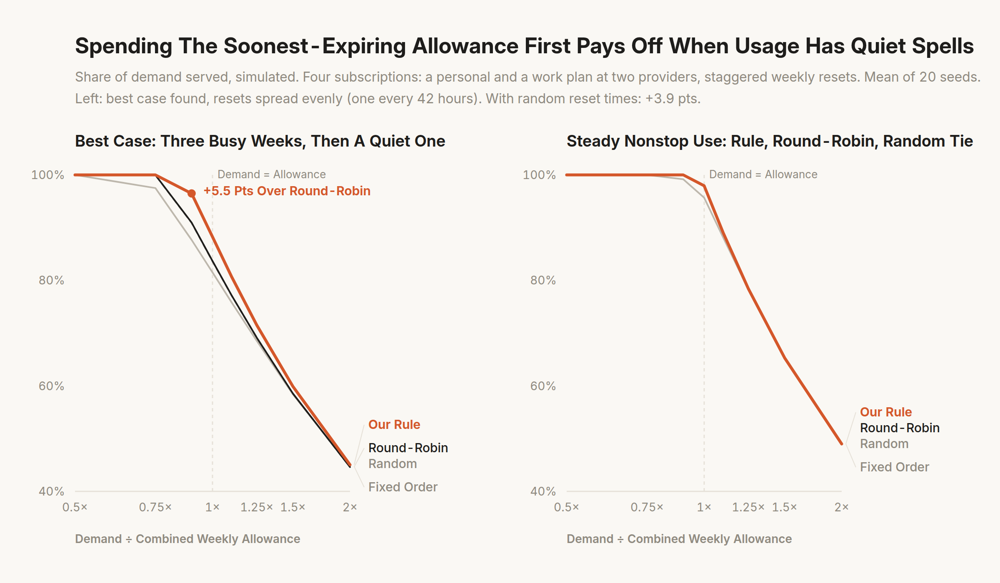
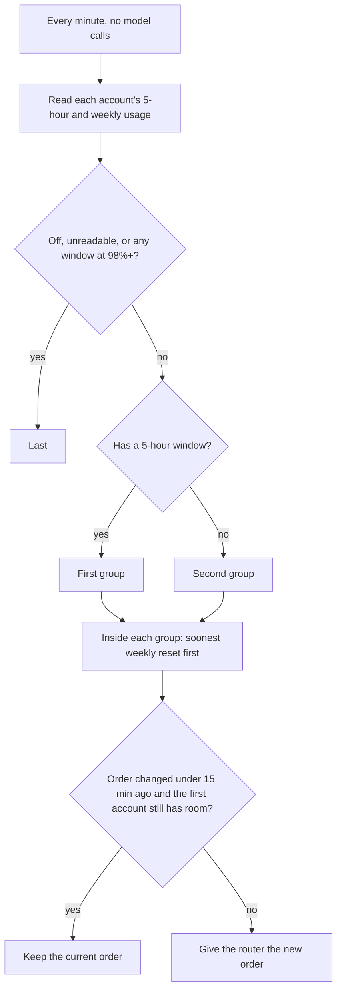

# Optimal Subs Router

Say you have four LLM subscriptions: a personal and a work plan at one provider, and a personal and a work plan at another. Each has a 5-hour window and a weekly limit, and each weekly limit resets at a different time. Both limits are use-it-or-lose-it. This repo has a one-line rule for which account your router should try first, a simulator to check it on your own traffic, a synthetic benchmark, and a skill file so your coding agent can set it up for you.

**The rule:** use the accounts with a 5-hour window first while they have room, then whichever account's weekly limit resets soonest.

## What it buys you (simulated)

We benchmarked the rule against round-robin, a random order and a fixed order on four subscriptions with staggered weekly resets. The scenarios are synthetic: 20 seeds per point, each with its own reset times, plan limits and timing. Below are the mean and the range across seeds of how much of the demand the subscriptions served.

**Where the rule matters most: three busy weeks, then a quiet week.** Take a person who works hard for three weeks and then takes a week off, with the four weekly resets spread across the week. Here the rule serves **5.5 points more of the demand than round-robin** at 0.9× the combined weekly allowance: 96.5% against 91.0%. The gap ranged from +3.0 to +8.1 points (sd 1.6), and the rule was ahead in all 20 seeds. Every account was out at once for 3.3 hours a week with the rule, against 9.1 with round-robin. We picked this pattern because it had the largest mean gap of the patterns we searched (see below), so treat it as the best case, not the typical one.

**Under steady nonstop use, the rule, round-robin and random tie.** With demand 16 hours a day or 24/7, their means stay within 0.1 point at every intensity from 0.5× to 2×. A fixed order loses ground near 1×: 95.7% served against 98.0%.

| Usage pattern | Demand | Rule | Round-robin | Fixed order | Rule − round-robin (range) | Rule ahead / tie / behind |
|---|---:|---:|---:|---:|---|---|
| Three busy weeks, then a quiet week; resets spread evenly | 0.9× | 96.5% | 91.0% | 87.7% | +5.5 (+3.0 to +8.1) | 20 / 0 / 0 |
| Same, at 1× | 1× | 88.3% | 83.7% | 81.5% | +4.6 (+0.4 to +7.3) | 20 / 0 / 0 |
| A sprint week, then a light week | 1× | 93.5% | 88.3% | 85.8% | +5.2 (−0.4 to +12.3) | 19 / 0 / 1 |
| After a break: every account fresh, next 2 weeks | 1.25× | 96.1% | 91.9% | 88.3% | +4.1 (+1.3 to +8.0) | 20 / 0 / 0 |
| Three busy weeks, then a quiet week; resets at random times | 0.9× | 94.2% | 90.3% | 87.4% | +3.9 (+1.1 to +6.9) | 20 / 0 / 0 |
| Usage that swings day to day | 1× | 94.3% | 92.4% | 88.9% | +1.9 (−1.5 to +6.1) | 16 / 0 / 4 |
| Short bursty sessions | 1× | 95.9% | 95.6% | 91.6% | +0.4 (−4.1 to +3.3) | 12 / 3 / 5 |
| Steady, 16 hours a day | 1× | 97.9% | 98.0% | 95.7% | 0.0 (−0.8 to +0.3) | 1 / 16 / 3 |
| Steady, 24/7 agents | 1× | 97.9% | 98.0% | 96.2% | −0.1 (−0.4 to +0.0) | 0 / 14 / 6 |
| Busy weekdays, quiet weekends | 1× | 97.4% | 98.0% | 94.8% | −0.5 (−6.2 to +0.4) | 1 / 8 / 11 |
| Three plan sizes at one provider (small, medium, large), steady | 1× | 97.4% | 98.0% | 95.2% | −0.6 (−5.2 to +0.1) | 1 / 16 / 3 |

"Tie" means within 0.1 point. Each row is shown at the demand level where its gap is largest or most typical; every level from 0.5× to 2× is in [`results/synthetic-benchmark.json`](results/synthetic-benchmark.json). Far below the allowance every policy serves 100%. Far above it every policy saturates: at 2× the steady-state gaps are under half a point (after a break the rule still leads by 2.2).

Why the rule helps: allowance is lost when an account reaches its weekly reset with room left. A quiet spell leaves room on every account. The rule spends the allowance that expires soonest first and keeps the late-resetting accounts for the busy days that follow. Round-robin drains every account evenly, so each one still has room when it resets. Under steady demand the rule, round-robin and random tie: below the allowance everything gets served, and above it each of them empties every account before its reset. A fixed order can still lose under steady demand, because the account it puts last may reach its reset with room left (at 1.1× it serves 88.2% against 89.1%).

It doesn't win everywhere. With busy weekdays and quiet weekends it averages 0.5 points behind round-robin, and behind in 11 of 20 seeds. The likely reason is that by Monday it has drained the soon-resetting accounts one at a time, so fewer accounts have room when the week's demand starts. In our search, a heavy day timed just before one account's reset was also worse for the rule (−2.7 points at 1×). How the resets are laid out matters too. With all four resets bunched within one day, the quiet-week gap shrank to about +0.3 points.



Round-robin also moves work between accounts on almost every request. Prompt caches are per account, so the rule's longer stays on one account may save cache misses. That is reasoning, not something this benchmark measures.

### How the showcase pattern was picked

On the four subscriptions we tried these candidates, each for 20 seeds at 0.7× to 1.5× demand: busy weekdays with quiet or light weekends, alternating sprint and light weeks (and sprint weeks with weeks off), three busy weeks then a quiet week, nightly agent batches on top of daytime work, a heavy day just before one account's reset, and usage that swings day to day. The two best patterns were also tried with resets spread evenly and bunched within one day. We excluded anything a real person wouldn't plausibly do, such as demand timed to round-robin's rotation. The largest mean gap was three busy weeks then a quiet week, with evenly spread resets: +5.5 points at 0.9×. Next came a sprint week then a light week (+5.2 at 1×, with a much wider spread) and the quiet-week pattern with random resets (+3.9). The search itself lived outside the repo. The patterns it picked are reproduced by `npm run bench`.

## How it works



The rule doesn't care which provider an account belongs to. If all your subscriptions have a 5-hour window, it reduces to "soonest weekly reset first, among accounts with room".

## Use it

Tell your agent:

> Implement the skill in https://github.com/andrewsiah/optimal-subs-router for my LLM subscriptions. Run it dry for a day before applying.

The agent reads [SKILL.md](SKILL.md). The rule needs two things from your setup: something that reports each subscription's 5-hour and weekly usage with reset times, and a router or agent launcher that takes an account priority list. `examples/rotate-from-json.mjs` sits between them. It reads a JSON snapshot of your accounts, prints the order the rule wants, and can hand a new order to a small install command you write for your router. Spreading work across providers needs a router or agent setup that can send the same task to either.

Or by hand:

```bash
node examples/rotate-from-json.mjs accounts.json                     # print the decision
node examples/rotate-from-json.mjs accounts.json --apply ./install   # install it (run every minute from a timer)
```

`accounts.json` lists your accounts in the order the router uses now, each as `{ id, on, error, weekly: { used, resetsAt }, fiveHour: { used, resetsAt } | null }`. With `--apply`, the new order goes to your command's stdin as a JSON array, and the change time is kept in `~/.local/state/optimal-subs-router` so the 15-minute hold works across runs.

## Run the benchmark

```bash
npm run bench    # about 20 minutes on 4-5 cores; writes results/synthetic-benchmark.json
npm run chart    # redraws docs/served.png (needs Chrome; INTER_FONT=path/to/Inter for the font)
node scripts/bench.mjs --seeds 2 --out /tmp/quick.json   # a quick look
```

Results depend only on the seeds, not on worker count or timing.

## Check it on your own traffic

```bash
node src/simulate.mjs accounts.json demand.jsonl 2026-01-31T00:00:00Z 4 1
```

This compares the rule, round-robin and every fixed order on your log (with up to 5 accounts; above that, only the order in your file). [SKILL.md](SKILL.md#check-it-on-your-own-log) explains the two input files and how to calibrate each account from its quota history. If your demand is steady, or far below or far above what your accounts hold, expect the rule, round-robin and random to come out about the same.

## Method and limits

- **Simulated, not measured.** No real logs are used. One-minute steps.
- **Subscriptions.** Plan limits are made-up tiers in relative units: 1 unit is one weekly allowance of a small personal plan. Each seed jitters every limit by up to ±25% and puts every weekly reset at a random minute of the week. The showcase cell spreads the resets evenly instead, one every 42 hours, from a random start and in a random account order.

  | Subscription | Plan tier | Weekly allowance (units) | One 5-hour window, % of weekly |
  |---|---|---:|---:|
  | Provider A, personal | Medium | 3.5 | 14 |
  | Provider A, work | Work seat | 1.25 | 10 |
  | Provider B, personal | Large | 5 | 15 |
  | Provider B, work | Work seat | 1 | 20 |

  The three-plan-sizes check uses a small (1 unit, 9%), a medium (3.5, 14%) and a large (6, 30%) plan at one provider.

- **Work is interchangeable across providers.** This is an assumption: an agent task can run on either, and one unit of work costs the same share of allowance on any account of the same size.
- **Demand.** Demand intensity is demand per measured week divided by the combined weekly allowance. It is exact in every seed. The models:
  - **Keeps blasting:** steady demand 16 hours a day, 7 days a week.
  - **Agents 24/7:** steady demand around the clock.
  - **Bursty:** random sessions of about 1.5 hours on and 2 hours off during waking hours.
  - **Uneven days:** the same hours, with each day's level drawn from 0 to 2× the mean.
  - **Busy weeks, then quiet:** three weeks of waking-hours work, then a week with nothing sent.
  - **Sprint weeks:** a week at 1.6× the mean, then a week at 0.4×.
  - **Weekdays:** busy weekdays, nothing on weekends.
- **Policies.**
  - **The rule:** `src/rotation.mjs`, with its 15-minute hold.
  - **Round-robin:** per request, over the accounts with room. A full account drops out and the others split its share. This is a fair round-robin, not a strawman.
  - **Random:** a fresh random order every minute, failing over to the next account with room.
  - **Fixed order:** one random order per seed, with the same failover.
- **Steady state.** Steady-state runs start with every weekly allowance spent, warm up for 4 weeks, then measure 4. Starting full would hand every policy a bank of unspent allowance. Near 1× demand that bank takes months to drain, and it favours the rule; the after-a-break case measures exactly that effect. The after-a-break case starts full and measures the first 2 weeks.
- **Metrics.**
  - **Demand served:** the share the subscriptions could serve. This is the main measure.
  - **All-out hours:** hours a week with every account out of quota.
  - **Wasted allowance:** weekly allowance left at resets inside the measured weeks. Below the allowance this is mostly allowance that demand never asked for (at 0.5× every policy wastes about half). Room still unspent when the run ends isn't counted, which flatters the rule a little near 0.9×, so prefer demand served.
- **The 98% guard.** The 98% guard keeps 2% of every allowance unspent. In the steady-state cells, once demand reaches the allowance no policy can serve more than 98% of it. After a break the allowance already banked adds to that, so a policy can serve more.
- 4 subscriptions and a handful of demand shapes are a small sample, and the showcase pattern was chosen as the best case among them. Run the simulator on your own log before trusting these numbers.

## Files

- `src/rotation.mjs`: the rule, `hasRoom()`, `orderAccounts()` and `decide()` with the 15-minute hold
- `src/simulate.mjs`: the simulator and the replay CLI
- `src/synthetic.mjs`: synthetic plan tiers, accounts and demand models for the benchmark
- `scripts/bench.mjs`, `scripts/chart.mjs`: the benchmark and its chart
- `results/synthetic-benchmark.json`: the full benchmark results
- `examples/rotate-from-json.mjs`: runs the rule on a JSON snapshot and hands the order to your router
- `test/`: `npm test` (Node 20+, no dependencies)

## License

[MIT-0](LICENSE). Copy it, no attribution needed.
